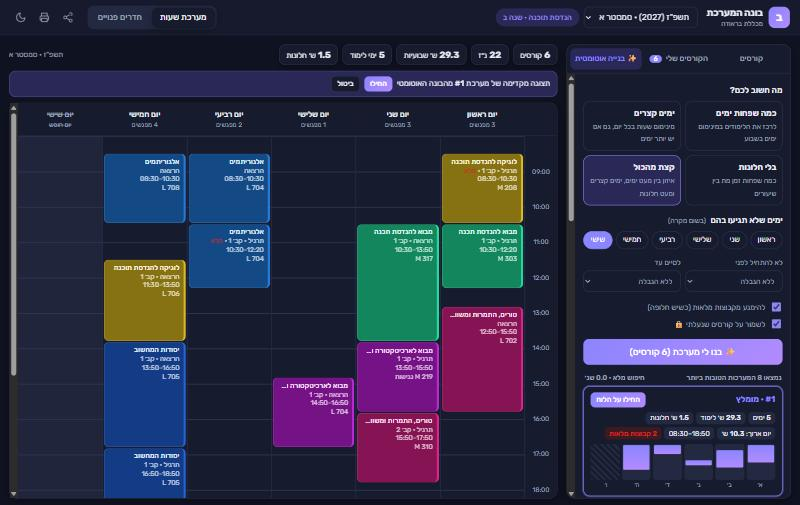

<div dir="rtl">

# 🎓 בונה המערכת – מכללת בראודה

**בוחרים את הקורסים של הסמסטר, והאתר בונה לכם את מערכת השעות הטובה ביותר.**

סינון לפי מגמה ושנת לימודים, סילבוס בתוך האתר, לוח שבועי אינטראקטיבי, ובונה אוטומטי שמוצא את השילוב הטוב ביותר של קבוצות לפי ההעדפות שלכם. ברירת המחדל היא **תשפ״ז (2027) – סמסטר א׳**.



> פרויקט לא רשמי. אין קשר למכללת בראודה. הנתונים נלקחים מהידיעון הציבורי של המכללה, וכדאי תמיד לוודא את פרטי ההרשמה באתר הרשמי.

## ✨ מה אפשר לעשות

### 🎯 קורסים לפי מגמה
- בוחרים מגמה ושנת לימודים, ורואים רק את הקורסים שרלוונטיים לכם.
- קורס שמשותף לכמה מגמות מופיע בכל אחת מהן.
- התגיות מסבירות למה הקורס מופיע: "חובה" לפי תוכנית הלימודים, ו"במערכת שנה X" לפי השיבוץ בפועל השנה.
- חיפוש לפי שם או מספר קורס, ואפשרות להציג את הקורסים של כל המגמות.

### 📄 דף קורס
- תיאור הקורס מהידיעון, נקודות זכות ושעות שבועיות.
- כל הקבוצות, עם מרצה, מועדים, חדר, ציון אם הקבוצה מלאה, ותרגולים ומעבדות שמקושרים להרצאה.
- **הסילבוס מוצג בתוך האתר** כטקסט נקי, ובלחיצה אפשר לעבור לעמודי ה-PDF המקוריים.
- כפתור **"פתח את דף הקורס באתר המוסד"**, שפותח את הדף הרשמי של השנה הנכונה.

### 🗓️ לוח שבועי אינטראקטיבי
- ימים א׳–ו׳, בשעות 08:00–23:00.
- כשמוסיפים קורס, האתר בוחר אוטומטית את הקבוצות שמתאימות הכי טוב ללוח הקיים.
- לוחצים על קורס, וכל הקבוצות האחרות שלו מופיעות כמשבצות מקווקוות. לוחצים על אחת מהן כדי לעבור אליה.
- התנגשויות מסומנות באדום.
- שורת סיכום עם נ״ז, שעות שבועיות, מספר ימים וזמן מת בין שיעורים ("חלונות").

### 🤖 בנייה אוטומטית של המערכת
בוחרים מטרה:

| מטרה | מה היא עושה |
|---|---|
| **כמה שפחות ימים** | מרכזת את הלימודים במינימום ימים בשבוע |
| **ימים קצרים** | מינימום שעות בכל יום |
| **בלי חלונות** | כמה שפחות זמן מת בין שיעורים |
| **קצת מהכול** | איזון בין כל השיקולים |

ואפשר להוסיף:
- **ימי חופש:** ימים שבהם לא תהיה אף שעה, בשום מקרה.
- שעה מוקדמת להתחלה ושעה מאוחרת לסיום.
- העדפה של קבוצות שאינן מלאות.
- נעילה של קבוצות שכבר בחרתם.

הבונה עובר על כל השילובים החוקיים: הרצאה אחת לכל קורס, ותרגיל או מעבדה מתוך הקבוצות שמקושרות להרצאה שנבחרה. הוא מדלג על שילובים שלא יכולים לנצח (branch and bound), ולכן מוצא את המערכות הטובות ביותר תוך פחות משנייה. כל תוצאה מגיעה עם סטטיסטיקה ותצוגה מקדימה על הלוח, ומחילים אותה בלחיצה.

### ועוד
🏫 חדרים פנויים · 🌙 מצב כהה · 📱 תצוגה מותאמת לטלפון · 🖨️ הדפסה · 🔗 קישור לשיתוף המערכת

## 🚀 הרצה

צריך [Node.js](https://nodejs.org) בגרסה 20 ומעלה. אין תלויות חיצוניות.

```bash
git clone https://github.com/davidio7883-debug/braude-schedule-builder.git
cd braude-schedule-builder
npm run dev        # http://localhost:5173
```

נתוני 2027 כבר כלולים במאגר. כדי לרענן אותם מהידיעון:

```bash
npm run scrape         # בערך 10 דקות בפעם הראשונה; הרצה חוזרת באותו יום מהירה בזכות המטמון
npm run scrape:fresh   # סריקה מלאה בלי מטמון
node scraper/scrape.mjs --year 2026   # שנה אחרת; היא תתווסף לבחירה באתר
npm test               # בדיקות לבונה האוטומטי, גם על הנתונים האמיתיים
```

## 📊 מאיפה הנתונים

כל הנתונים נלקחים מ**תחנת המידע הציבורית של המכללה** (`info.braude.ac.il/yedion`), שלא דורשת התחברות:

| נתון | מקור בידיעון |
|---|---|
| הקורסים שנלמדים השנה | חיפוש לפי אות ראשונה ומערכת השעות המלאה |
| קבוצות, מועדים, חדרים, קבוצות מקושרות ותיאור | דף הקורס |
| שיוך למגמה ולשנה | קבוצות הלימוד של כל מגמה ותוכניות הלימודים |
| סילבוס | `info.braude.ac.il/info/<שנה>/<מספר קורס בן 7 ספרות>.pdf` |

לגבי הסורק:
- הוא שולח בערך בקשה אחת בשנייה ושומר את התשובות במטמון.
- אם דף קורס בידיעון לא מחזיר קבוצות, הסורק מנסה את [braude.top](https://braude.top/braude) כגיבוי.
- פרטי המחקר המלאים נמצאים בקובץ [`research/findings.md`](research/findings.md).

## 🗂️ מבנה הפרויקט

```
scraper/        הסורק: firefly.mjs (לקוח לידיעון), parse.mjs, scrape.mjs, braudetop.mjs (גיבוי)
public/         האתר (HTML/CSS/JS בלי שלב בנייה)
  js/model.js       כללי הקבוצות: הרצאה ותרגיל/מעבדה מקושרים
  js/optimizer.js   חיפוש עם גיזום (branch and bound) שרץ ב-Web Worker
  data/             הנתונים שהסורק יצר (JSON)
server.mjs      שרת קטן: קבצים סטטיים, וטעינה של הסילבוס להצגה בתוך האתר
test/           בדיקות
research/       מחקר מקדים ודוגמאות
```

## 💡 טיפים

- **מעבדה שמתקיימת אחת לשבועיים:** הידיעון לא מציין שבועות מתחלפים, ולכן שתי מעבדות כאלה ייראו כהתנגשות. בלשונית "הקורסים שלי" אפשר לסמן לקורס **"לאפשר חפיפה"**.
- **תרגול שרשום בתוך שעות ההרצאה:** כך זה מופיע בידיעון, וזה לא נחשב התנגשות.

## ⚠️ מגבלות ידועות

- **סמסטר ב׳ תשפ״ז:** עוד לא פורסם במלואו בידיעון. יש קבוצות, אבל עדיין בלי שעות. כשהשעות יפורסמו, מריצים שוב `npm run scrape`.
- **מועדי בחינות:** עדיין לא פורסמו לשנת 2027, ולכן הם לא מוצגים.
- **כל הקורסים של קבוצת שנה יחד:** בחלק מקבוצות השנה יש כמה קורסי בחירה או התמחויות באותה שעה. אם בוחרים את כולם, אין מערכת בלי התנגשויות, וזה המצב האמיתי בידיעון. הבונה יודיע על כך.
- **הקישור לאתר המכללה:** הכפתור פותח לשונית חדשה ומחליף בה את השנה. אם הדפדפן חוסם חלונות קופצים, תופיע הודעה.
- **שרת:** הצגת הסילבוס בתוך האתר דורשת את השרת המצורף (`npm run dev`). בלי השרת, הסילבוס נפתח בצורה הרגילה של הדפדפן.

</div>

---

## English

**Braude Schedule Builder** is a smart timetable planner for students at ORT Braude College (Karmiel, Israel). The UI is in Hebrew.

- **Degree-aware course list:** pick your degree and study year to see only the courses that apply to you. Courses shared by several degrees appear under each one.
- **Course pages** show the catalog description, every group (lecturer, times, room, full or open), the **syllabus rendered in-app**, and a link to the official course page for the correct academic year.
- **Interactive weekly board** (Sunday–Friday, 08:00–23:00) with one-click group switching and clash highlighting.
- **Auto-builder:** a branch-and-bound search that runs in a Web Worker. It takes one lecture per course plus a tutorial or lab linked to that lecture, and finds the best clash-free combinations for your goal: fewest days, short days, no gaps, or balanced. It also respects hard days off, earliest and latest hours, a preference for open groups, and locked groups.
- **Data:** scraped from Braude's public yedion (`info.braude.ac.il`) by a polite, cached Node scraper, with [braude.top](https://braude.top/braude) as a fallback.

```bash
npm run dev       # serve the app at http://localhost:5173 (Node 20+, no dependencies)
npm run scrape    # refresh the data from the official yedion
npm test          # optimizer tests, including runs on real data
```

*Unofficial project, not affiliated with ORT Braude College. Always confirm registration details on the official site.*
